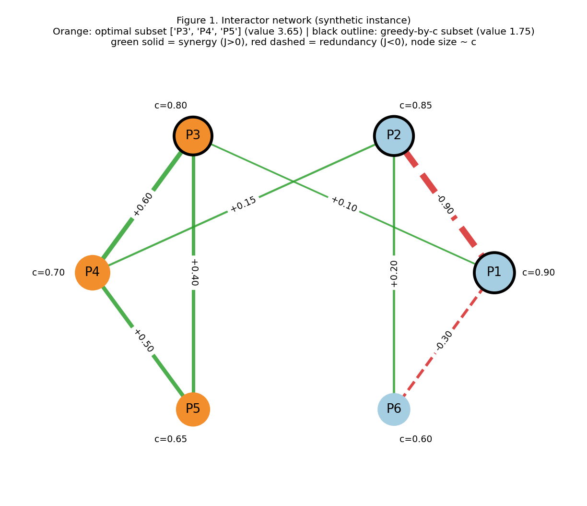
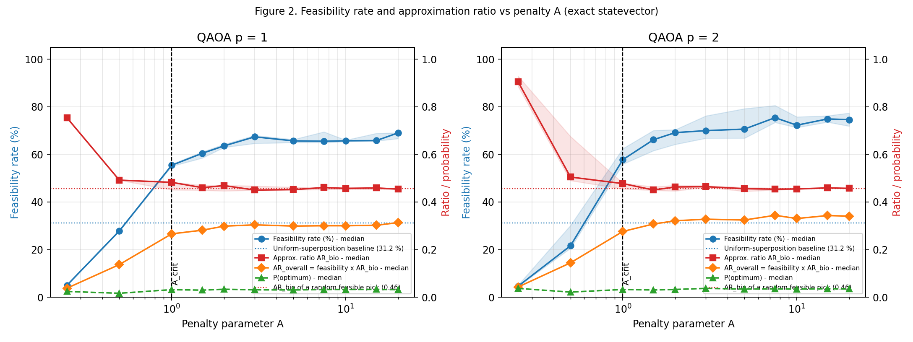
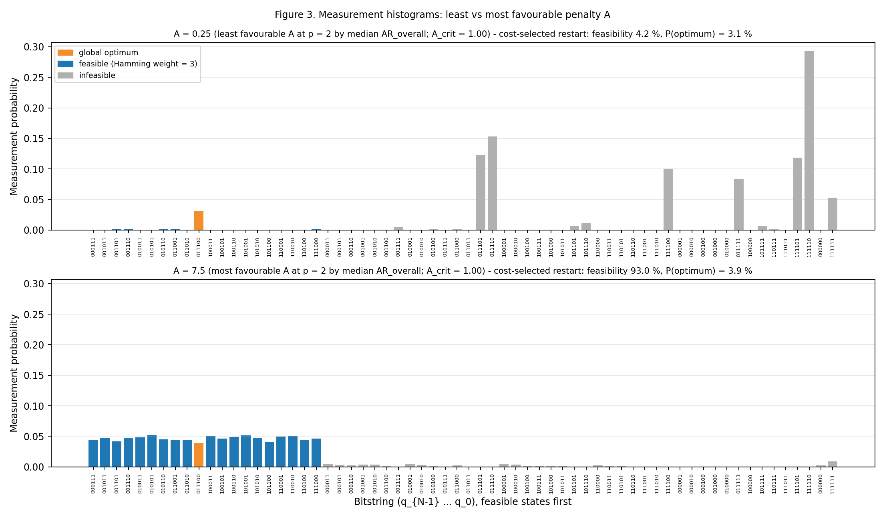

# Sensitivity of the penalty parameter in QAOA for protein-interactor selection under budget constraints

**Category:** Quantum Impact (tag: `quantum-impact`)
**Hackathon:** Qollab × IonQ

> **This effort is supported by Qollab & IonQ.**

## Summary

Selecting exactly *k* of *N* candidate protein interactors, where each candidate has a confidence score and pairs can be synergistic or redundant, is a small budgeted-selection problem. Encoding the hard budget Σxᵢ = k as a quadratic penalty A·(Σxᵢ − k)² creates a tuning problem: if A is too small the lowest-energy states violate the budget, and if A is large the biological signal is compressed relative to the penalty.

This project measures that trade-off for QAOA (p = 1 and p = 2) on a synthetic 6-protein instance (k = 3) over 11 values of A (0.25 to 20), with 8 random COBYLA restarts per setting. We report the **feasibility rate** (share of shots with Hamming weight k), **approximation ratios** against the exact classical optimum, and the **probability of sampling the optimum**, always next to simple baselines.

**Main findings (exact simulation, no noise):**

- Calibrating A is essential for **feasibility**: it rises from ~5 % at A = 0.25 to 55–58 % at the analytic critical value A_crit = 1.0 and plateaus at 65–75 % for A ≥ 3 (uniform sampling gives 31 %).
- Calibrating A does **not** make QAOA find the optimum much more often at these depths. The probability of sampling the optimum stays at about 3–4 % for every A (uniform: 1.6 %), and the quality among feasible samples stays at the level of a random feasible pick (AR_bio ≈ 0.46).
- Large A pushes the sampled distribution into the feasible subspace but flattens it: at A = 7.5 the 20 feasible states have nearly equal probability (see Figure 3). The normalized energy gap of the optimum shrinks as A grows (0.029 at A = 1.5, 0.003 at A = 20).
- Without rescaling the Hamiltonian, increasing A does not even buy feasibility (31–45 %): the energy scale grows with A and the optimizer stalls (ablation below).

The instance is **synthetic and illustrative**. It does not use data from any real experiment.

## Novelty and Creativity

Penalty calibration is a well-known issue in QUBO/Ising formulations (see Lucas, *Frontiers in Physics* 2014) and constraint-preserving alternatives exist (Hadfield et al., *Algorithms* 2019). We do not claim a new algorithm. The contribution is a **small, fully reproducible, instance-level study** that makes the calibration trade-off concrete for a biomedical-style selection problem:

- an **analytic critical penalty** A_crit, computed exactly, above which the ground state of H is the constrained optimum;
- a **normalized gap** diagnostic that quantifies how much biological signal survives as A grows;
- feasibility, approximation ratio and probability of the optimum reported **together** and against three baselines (uniform superposition, random feasible pick, greedy-by-confidence), so that an apparently good number is not mistaken for useful behaviour;
- a deliberately built instance in which **greedy selection by confidence is a trap** (the two highest-scoring proteins are redundant with each other, while three lower-scoring proteins form a synergistic complex);
- an ablation showing the effect of the energy scale that A introduces.

On the question of calibrating A "without destroying the signal of J_ij": the data show that some of the signal is lost whenever A is raised, and that at p ≤ 2 QAOA with the standard mixer does not recover J_ij-driven structure at any A tested. The useful range found here is a moderate multiple of A_crit (about 2–3×), beyond which feasibility gains are small while the gap keeps shrinking.

## Technical Execution

**Problem and QUBO.** With xᵢ ∈ {0, 1}, confidence scores cᵢ and pair terms J_ij (J_ij > 0 synergy, J_ij < 0 redundancy, i < j):

```
value(x) = Σ cᵢ xᵢ + Σ_{i<j} J_ij xᵢ xⱼ                         (maximize)
H(x)     = − Σ cᵢ xᵢ − Σ_{i<j} J_ij xᵢ xⱼ + A (Σ xᵢ − k)²        (minimize)
```

Using xᵢ² = xᵢ, the penalty expands to A Σxᵢ + 2A Σ_{i<j} xᵢxⱼ − 2Ak Σxᵢ + Ak², so the QUBO coefficients are

```
lᵢ  = −cᵢ + A (1 − 2k)         (linear)
qᵢⱼ = −J_ij + 2A               (quadratic)
```

**Ising/Pauli mapping.** Substituting xᵢ = (1 − Zᵢ)/2 gives

```
H = const + Σ hᵢ Zᵢ + Σ_{i<j} wᵢⱼ ZᵢZⱼ
wᵢⱼ  = qᵢⱼ / 4
hᵢ   = − lᵢ / 2 − Σ_{j≠i} qᵢⱼ / 4
const = A k² + Σ lᵢ / 2 + Σ_{i<j} qᵢⱼ / 4
```

The operator is built as a `SparsePauliOp` and the script **verifies it against the QUBO energies of all 2^N bitstrings** (maximum difference < 10⁻⁹) before every run. Qubit i corresponds to bit i (Qiskit little-endian).

**Critical penalty.** For an infeasible x with s = Σxᵢ, H(x) > H(x*) holds if and only if A (s − k)² > value(x) − value(x*). Hence

```
A_crit = max over infeasible x of  ( value(x) − value(x*) ) / (s − k)²
```

For this instance **A_crit = 1.000**. Below it, the ground state of H violates the budget; above it, the ground state is the constrained optimum (this is a condition on the ground state, not a guarantee that QAOA finds it).

**Normalization.** By default H is divided by its spectral range (E_max − E_min) so that the cost-layer angle γ has a comparable meaning for every A. The range is obtained by enumeration, which is only possible for small N (for larger problems a bound would be used). `--no-normalize` disables this and is used for the ablation.

**Instance (N = 6, k = 3).** Confidence scores c = [0.90, 0.85, 0.80, 0.70, 0.65, 0.60] for P1–P6. Redundancy: J₁₂ = −0.90, J₁₆ = −0.30. Synergistic complex: J₃₄ = +0.60, J₄₅ = +0.50, J₃₅ = +0.40. Minor synergies: J₁₃ = +0.10, J₂₆ = +0.20, J₂₄ = +0.15. Classical results by exact enumeration:

| Selection | Subset | Value | AR_bio |
|---|---|---|---|
| Global optimum | {P3, P4, P5} | 3.65 | 1.00 |
| Greedy by confidence | {P1, P2, P3} | 1.75 | 0.17 |
| Random feasible pick (expected) | — | — | 0.46 |

`--n 5` selects the 5-protein sub-instance and `--k 2` a budget of 2.

**QAOA circuit.** `qiskit.circuit.library.QAOAAnsatz` with depth p ∈ {1, 2}: uniform superposition, cost layers exp(−iγH), RX(2β) mixers. The penalty adds 2A to every pair coupling, so for every A in the grid except A = 0.25 the cost layer contains all 15 ZZ terms (a complete graph); at A = 0.25 the P4–P5 term cancels because J₄₅ = 0.50 = 2A, leaving 14. Each ZZ term costs two CX gates after transpilation (30 CX per layer for p = 1 and 60 for p = 2 at A = 2, as measured), so the circuit size is essentially independent of A. The circuit is transpiled once per (A, p) to {rz, sx, x, cx}.

**Optimization.** COBYLA (SciPy) with initial trust radius 0.5, tolerance 10⁻³, at most 400 evaluations. Initial angles are γ ~ U(0, 2π) and β ~ U(0, π), with 8 independent restarts per (A, p). The cost is ⟨H⟩ from `StatevectorEstimator` (exact). The final distribution is sampled with `StatevectorSampler` (8192 shots). The restart "selected by cost" is the one with the lowest final cost, which needs no knowledge of the optimum.

**Metrics.**

| Metric | Definition |
|---|---|
| Feasibility rate | % of shots whose bitstring has Hamming weight (number of ones) equal to k |
| AR_bio | Mean objective value of the feasible shots, normalized between the worst and the best feasible solution; 0 if there are no feasible shots. Must be read together with the feasibility rate |
| AR_overall | Feasibility × AR_bio (infeasible shots count as zero) |
| P_opt | Probability of sampling the global optimum |
| Expected shots to optimum | 1 / median P_opt |
| AR_H | Standard QAOA ratio (E_max − ⟨H⟩) / (E_max − E_min), saved in `metrics.csv` |

**Sensitivity grid.** A ∈ {0.25, 0.5, 1, 1.5, 2, 3, 5, 7.5, 10, 15, 20} and p ∈ {1, 2}, i.e. 176 optimization runs per backend.


*Figure 1. Interactor network of the synthetic instance. The optimal subset is highlighted in orange; the black outline marks the greedy-by-confidence subset.*

## Results

**Exact simulation** (medians over 8 restarts; the full table with IQRs and cost-selected runs is in `results/exact/summary.md`):

| A | A / A_crit | Normalized gap | Feasibility % (p=1 / p=2) | AR_bio (p=1 / p=2) | AR_overall (p=1 / p=2) | P_opt % (p=1 / p=2) |
|---|---|---|---|---|---|---|
| 0.25 | 0.25 | −0.119 | 5.0 / 4.6 | 0.754 / 0.905 | 0.038 / 0.043 | 2.4 / 3.7 |
| 0.5 | 0.5 | −0.058 | 27.9 / 21.6 | 0.492 / 0.505 | 0.137 / 0.144 | 1.7 / 2.1 |
| 1 | 1.0 | 0.000 | 55.4 / 57.8 | 0.483 / 0.477 | 0.266 / 0.276 | 3.2 / 3.2 |
| 2 | 2.0 | 0.025 | 63.6 / 69.1 | 0.469 / 0.463 | 0.299 / 0.321 | 3.3 / 3.3 |
| 3 | 3.0 | 0.018 | 67.4 / 70.0 | 0.450 / 0.464 | 0.304 / 0.328 | 3.1 / 3.7 |
| 7.5 | 7.5 | 0.008 | 65.5 / 75.4 | 0.461 / 0.454 | 0.300 / 0.344 | 3.2 / 3.5 |
| 20 | 20 | 0.003 | 69.0 / 74.6 | 0.454 / 0.457 | 0.313 / 0.341 | 3.2 / 3.5 |

Baselines: uniform superposition gives 31.25 % feasibility and 1.56 % P_opt; a random feasible pick gives AR_bio = 0.457.


*Figure 2. Feasibility rate (left axis) and approximation ratios / probability of the optimum (right axis) versus A, for p = 1 and p = 2. Shaded bands are interquartile ranges over restarts; the dashed vertical line is A_crit. At A = 0.25 the conditional AR_bio looks high only because just ~5 % of shots are feasible.*


*Figure 3. Measurement histograms (p = 2, cost-selected restart) for the least favourable A (0.25) and the most favourable A (7.5), both chosen by median AR_overall. At A = 0.25 the mass sits on infeasible states with many selected proteins. At A = 7.5 it is spread almost evenly over the 20 feasible states; the optimum (orange) is not singled out.*

A supplementary Figure 4 (`results/exact/fig4_gap_vs_A.png`) plots the normalized gap against A.

**Trade-off analysis.**

| Region of A | Feasibility | Selectivity among feasible states | Remarks |
|---|---|---|---|
| A < A_crit (0.25, 0.5) | Low (5–28 %) | Looks high when conditioned, but on very few shots | The ground state of H violates the budget; the optimum is sampled with probability similar to other A values, but most shots are unusable |
| A ≈ A_crit (1) | Medium (55–58 %) | At the random-feasible level | Ground state is the constrained optimum with zero gap margin |
| A ≈ 2–3 × A_crit | High (64–70 %) | At the random-feasible level | Best compromise found: most of the feasibility gain with a still-moderate gap |
| A ≥ 5 × A_crit | Plateau (65–75 %) | At the random-feasible level | Gap shrinks roughly as 1/A; no further benefit; wider restart-to-restart variability |

Restart-to-restart variability is large at p = 2: for example at A = 7.5 the median feasibility is 75 %, but the restart selected by cost reached 93 %.

**Generic hardware-like noise (Aer, NOT calibrated to IonQ).** Depolarizing errors of 2·10⁻⁴ (single-qubit) and 5·10⁻³ (two-qubit), 4096 shots per cost evaluation. COBYLA stops after only ~22–46 evaluations under shot noise. Median feasibility for p = 2:

| A | Exact | Generic noise |
|---|---|---|
| 1 | 57.8 % | 48.3 % |
| 2 | 69.1 % | 59.1 % |
| 3 | 70.0 % | 65.3 % |
| 7.5 | 75.4 % | 66.9 % |
| 20 | 74.6 % | 65.3 % |

AR_bio stays at the random-feasible level and P_opt is 2.4–3.2 % for A ≥ 1. The full table is in `results/noisy_generic/summary.md`. These numbers illustrate the qualitative effect of noise; they are not predictions for IonQ hardware.

**Ablation: no spectral rescaling (`--no-normalize`).** Median feasibility with p = 1 stays at 32–36 % for A ≥ 3 and with p = 2 at 35–45 % (exact simulation), close to the 31 % uniform baseline, and COBYLA stops early (median ~30 evaluations for p = 1). Because the energy scale grows with A while the initial γ range is fixed, the landscape becomes highly oscillatory. This points to a parameter-scaling and initialization effect rather than an intrinsic limit: rescaling H (as in the main runs) or the initial γ range would be expected to repair it, but we did not test the second option. See `results/ablation_no_normalize/`.

## Impact Potential

This is a methodological guide for formulating selection problems with a hard budget on the Qollab platform. The checklist that follows from the experiments:

1. Define the individual scores and the pair matrix with an explicit sign convention (J > 0 synergy, J < 0 redundancy).
2. Compute A_crit (exactly for small N, or bound it by the largest gain obtainable by violating the budget) and choose A at a moderate multiple above it (here 2–3×).
3. Rescale the Hamiltonian so that γ is comparable across penalty values.
4. Report feasibility, a quality metric and the probability of the optimum together, against uniform, random-feasible and greedy baselines.
5. Expect that, at low depth, a penalty-based standard-mixer QAOA improves feasibility but not selectivity. If feasibility is a hard requirement, consider constraint-preserving mixers (XY mixer with a Dicke initial state), which keep every shot at Hamming weight k by construction, or post-select/repair feasible shots.

**What this does not show:** any advantage over classical methods (with N = 6 the classical search checks 64 states), behaviour at larger N, behaviour on IonQ hardware or with IonQ's calibrated noise, or results on real interactomics data.

## Documentation Quality & Reproducibility

This section explains how the card is organized and why, how to read the results, and how to check, rerun or extend every number. Everything described here refers to files in this folder.

### 1. How the card is organized, and why

The card is built so that a reader can stop at any depth and still hold a correct picture.

| If you have… | Read | You will learn |
|---|---|---|
| 2 minutes | *Summary* and its main findings | What was measured, the headline results, and what they do and do not show |
| 10 minutes | + *Novelty*, *Technical Execution*, *Results* and Figures 1–3 | How the problem is encoded, how the penalty A changes behaviour, and the trade-off |
| 30 minutes | + this section | How to verify, rerun or extend every number |

After reading, a reader should be able to (1) formulate a budgeted selection problem as a QUBO and a Pauli Hamiltonian, (2) compute the critical penalty A_crit and explain what happens below and above it, and (3) rerun the study or apply it to another instance.

| Design choice | Reason |
|---|---|
| Order: problem → mathematics → circuit → metrics → results → trade-off → guidance → limits | The derivation is written before the experiment, so each result can be traced back to a formula |
| A worked, verifiable chain: QUBO → coefficients lᵢ, qᵢⱼ → Pauli terms hᵢ, wᵢⱼ → `SparsePauliOp` | A reader can follow the algebra and the script checks it against all 2^N energies on every run |
| Every metric is defined in a table and reported next to baselines (uniform superposition, random feasible pick, greedy by confidence) | A good-looking number (for example a high approximation ratio on very few feasible shots) is never mistaken for useful behaviour |
| The instance is built so that greedy selection is a trap | The biological meaning of J_ij (synergy and redundancy) becomes visible in the answer, not just in the formulas |
| Results come with a trade-off table by region of A, a practical checklist, and an explicit "what this does not show" list | The reader leaves with guidance and with its limits |
| The same names are used in text, tables, figure legends, CSV columns and code (`A`, `p`, `feasibility_pct`, `AR_bio`, `P_opt`) | Any number can be cross-referenced without translation |

**Glossary.**

| Term | Meaning in this project |
|---|---|
| QUBO | Quadratic Unconstrained Binary Optimization: minimize a quadratic function of binary variables |
| Penalty parameter A | Weight of the term A (Σxᵢ − k)² that punishes selecting a number of proteins different from k |
| A_crit | Smallest A above which the ground state of H is the constrained optimum (1.000 for this instance) |
| Normalized gap | (energy of the best non-optimal state − energy of the optimum) / (E_max − E_min); negative if the optimum is not the ground state |
| QAOA depth p | Number of alternating cost and mixer layers (p = 1 and 2 are studied) |
| Restart | One independent COBYLA optimization from random initial angles (8 per setting) |
| Cost-selected run | The restart with the lowest final cost; it can be chosen without knowing the optimum |
| Feasibility rate | % of shots whose bitstring has Hamming weight (number of ones) equal to k |
| AR_bio | Mean objective value of the feasible shots, normalized between the worst and best feasible solution |
| AR_overall | Feasibility × AR_bio (infeasible shots count as zero) |
| P_opt | Probability of sampling the global optimum |
| Expected shots to optimum | 1 / median P_opt |

### 2. Reading the results

**Reading order for the main table** (in *Results* and in `results/exact/summary.md`).

| Column | Question it answers |
|---|---|
| A / A_crit and normalized gap | Where are we relative to the critical penalty, and how much signal is left? |
| Feasibility % | Do the shots respect the budget? |
| AR_bio | Among feasible shots, how good are they (0 = worst feasible, 1 = optimum)? |
| AR_overall | What is the quality if infeasible shots count as failures? |
| P_opt % | How often does a shot hit the optimum? |

**Figure guide.**

| Figure | Question | What to look at | Caveat |
|---|---|---|---|
| 1. Network | What is being selected? | Orange = optimum {P3, P4, P5}; black outline = greedy subset; green edges = synergy, red dashed = redundancy | Synthetic instance, not experimental data |
| 2. Feasibility and ratios vs A | What does A buy? | Blue (feasibility) rises to a plateau after A_crit while red (AR_bio) stays on the dotted random-feasible baseline | At A = 0.25 AR_bio looks high only because ~5 % of shots are feasible; read AR_overall (orange) |
| 3. Histograms | What does the sampled distribution look like? | At A = 0.25 the mass sits on infeasible states; at A = 7.5 it is spread over the 20 feasible states and the optimum (orange) is not singled out | Shows one cost-selected restart at p = 2; the two A values are chosen by median AR_overall |
| 4. Gap vs A (supplementary) | How much signal survives? | The normalized gap falls as A grows; negative below A_crit | Computed exactly by enumeration (small N only) |

**Where each number comes from.**

| Claim in the card | Source file |
|---|---|
| Main results table (exact simulation) | `results/exact/summary.md` |
| Noise comparison | `results/noisy_generic/summary.md` |
| Ablation without rescaling | `results/ablation_no_normalize/summary.md` |
| Instance, A_crit, classical optimum, greedy and random baselines, normalized gaps | `results/exact/run_metadata.json` (keys `instance`, `classical`, `normalized_gap`) |
| Every restart's metrics | `results/*/metrics.csv` |
| Measured distributions and optimal angles (used by Figure 3) | `results/*/records.jsonl` |
| Figures | `results/exact/fig1_network.png` … `fig4_gap_vs_A.png` (same four for the other runs) |

### 3. Reproducibility

**Environment (reference runs).** Python 3.12.3, Qiskit 1.4.6, Qiskit Aer 0.17.2, NetworkX 3.6.1, NumPy 2.4.4, SciPy 1.17.1, Matplotlib 3.10.8. See `requirements.txt` and `results/*/run_metadata.json`.

**Four ways to engage, from cheapest to most complete.**

| Level | Command | Time | What you get |
|---|---|---|---|
| 0. Inspect | Open `results/` | Minutes | Tables, figures and per-run data, no installation needed |
| 1. Rebuild tables and figures | `python qaoa_penalty_sensitivity.py --replot --outdir results/exact` | Seconds | Regenerates `summary.md` and the figures from `records.jsonl` |
| 2. Smoke test | `python qaoa_penalty_sensitivity.py --quick` | ~30 s | 3 values of A, 2 restarts, p = 1 and 2 |
| 3. Full reference runs | See below | ~7 min, ~2 min, ~2 min | The three result sets |

```bash
pip install -r requirements.txt

python qaoa_penalty_sensitivity.py --outdir results/exact                                # ~7 min (413 s measured), 1 CPU core
python qaoa_penalty_sensitivity.py --backend aer-noise --outdir results/noisy_generic     # ~2 min (132 s); needs qiskit-aer
python qaoa_penalty_sensitivity.py --no-normalize --outdir results/ablation_no_normalize  # ~2 min (108 s)
```

**Determinism.** All random choices are seeded (`--seed 7`, with a separate generator per A, p and restart), the exact backend has no sampling noise in the cost, and the final shot distribution uses a seeded sampler. In a check across sessions, a `--quick` run reproduced all 12 matching (A, p, restart) entries of the delivered full run exactly (evaluation counts, feasibility and final cost); timings are not reproducible.

**Checks built into the script.**
- Before every run, the Pauli Hamiltonian is compared against the QUBO energies of all 2^N bitstrings for every A in the grid; the script stops if the difference exceeds 10⁻⁹.
- The exact optimum, the greedy baseline, A_crit, the uniform-superposition feasibility and the random-feasible AR_bio are computed by enumeration and printed at the start.
- The restart used for the histogram is selected by cost, without access to the optimum.

**Output files (per run folder).**

| File | Content |
|---|---|
| `summary.md` | Results table |
| `metrics.csv` | One row per restart (`A`, `p`, `restart`, `nfev`, `time_s`, `cost_final`, `E_H`, `AR_H`, `feasibility_pct`, `AR_bio`, `P_opt`, exact-probability versions) |
| `records.jsonl` | Full records, including the measured distribution and optimal angles |
| `run_metadata.json` | Arguments, versions, wall time, instance, classical results, normalized gaps |
| `fig1_network.png`, `fig2_feasibility_ratio_vs_A.png`, `fig3_histogram.png`, `fig4_gap_vs_A.png` | Figures |
| `qollab_validation_records.jsonl` (project root) | Cost-selected restart for every (A, p), with optimal angles, for single-job validation |
| `results_qollab/validation_results.json`, `fig5_backend_validation_A<A>_p<p>.png` | Output of `--validate-on-backend` |
| `qollab_sampler.py` (project root) | Optional plug-in for `--backend custom` |

**Backends: what was tested.**

| Option | Status |
|---|---|
| `--backend statevector` (default) | Tested end-to-end; used for the exact results |
| `--backend aer-noise` | Tested end-to-end (generic depolarizing noise, **not** IonQ-calibrated) |
| `--backend ionq` | Implemented from IonQ's documentation (`qiskit-ionq` < 1.0 for Qiskit 1.x, `IONQ_API_KEY`, `--ionq-noise-model`). **Not tested** |
| `--backend qollab` | Uses the global `backend` that Qollab injects (no API key). One sampler call is allowed when the injected backend is an IonQ simulator (see below). Tested only with a *locally simulated* injected backend (Aer with generic noise), **not on Qollab itself** |
| `--backend custom --sampler-factory qollab_sampler.py:make_sampler` | Plug-in file `qollab_sampler.py` is included. Its `local` mode was tested end-to-end; its `qollab` mode behaves like `--backend qollab` (tested with the simulated injected backend); its `ionq-simulator` mode is untested |

**Running on Qollab (one job per run).** What follows is based on the platform information supplied by the author; it was not checked against Qollab's own documentation. In the Code Playground / Python projects the selected simulator is injected as a global `backend` (chosen in the *Run on Qollab / Select QPU* menu), no API key is needed, and the IonQ simulator's noise model is a string set with `backend.set_options(noise_model="forte-1")` (names reported: `forte-1`, `forte-enterprise-1`, `aria-1`, `aria-2`). Simulators are free; the remote IonQ simulators accept **one job per run**, and a single `backend.run([...])` call counts as one job even when it carries several circuits. The base libraries are `qiskit` 1.x, `numpy`, `scipy`, `matplotlib` and `networkx`.

Every COBYLA evaluation is one job, so the optimization cannot run on the Qollab backend. The study is therefore split in two:

| Step | Where | What |
|---|---|---|
| 1. Optimize | Local machine, exact statevector | `python qaoa_penalty_sensitivity.py --outdir results/exact` produces the full study |
| 2. Select | Already done | `qollab_validation_records.jsonl` keeps, for every (A, p), the restart selected by cost (22 records, with optimal angles) |
| 3. Validate | Qollab (needs only Qiskit, NumPy, SciPy and Matplotlib) | One sampler call (one circuit, one job) runs the stored angles for one value of A on the selected backend and compares the result with the noiseless distribution |

The Code Playground runs the file as a script and does not accept command-line arguments, so the script falls back to the list `QOLLAB_DEFAULT_ARGS` at the top of the file whenever it finds an injected `backend` and no arguments (A = 7.5, p = 2, 8192 shots). Without an injected `backend` (a normal local run) the same defaults reproduce the full study. To run step 3 upload `qaoa_penalty_sensitivity.py` and `qollab_validation_records.jsonl` to the project (uploaded files sit in the working-directory root, where the script looks for them), select the IonQ simulator and its noise model in the run menu and press Run. Each run validates one value of A, so edit `QOLLAB_DEFAULT_ARGS` and run again for others (for example A = 0.25). Outside the playground, or if arguments ever become available:

```bash
python qaoa_penalty_sensitivity.py --backend qollab --validate-on-backend \
    --records qollab_validation_records.jsonl --validate-A 7.5 --validate-p 2 \
    --final-shots 8192 --qollab-noise-model forte-1
```

The output is a table (feasibility, AR_bio, P_opt, AR_H: noiseless versus backend), `results_qollab/validation_results.json` and `results_qollab/fig5_backend_validation_A<A>_p<p>.png`. Before running anything, the script checks that the stored angles reproduce the stored cost for the instance and normalization in use, and, when the injected backend is an IonQ simulator (detected from its name, e.g. `ionq_simulator`), it stops with an explicit "job limit reached" error if a run attempts a second sampler call. Other injected backends are not limited unless `--max-jobs` is set.

*Status.* Tested only with a locally simulated injected backend (Aer, generic depolarizing noise of 2·10⁻⁴ per single-qubit gate and 5·10⁻³ per CX, **not** IonQ's). For A = 7.5, p = 2 the feasibility rate fell from 93.0 % (noiseless) to 79.3–79.7 % across four repeated simulated runs, P_opt from 4.2 % to about 3.4 %, and AR_bio stayed near 0.44–0.45 (0.446 noiseless), with 8192 shots. These numbers illustrate the procedure and say nothing about IonQ. **Validation results from Qollab itself are not yet included**; paste the table printed by the Qollab run here when available. Confirmed by the author, not independently checked: several circuits sent in one call count as one job (this study sends one circuit per run); the injected `backend` exposes the standard Qiskit configuration, so `transpile(circuit, backend=backend)` works (if it ever fails, the script prints a warning and falls back to the {rz, sx, x, cx} basis); the noise model is set with `backend.set_options(noise_model="forte-1")`, `forte-1` being the recommended default.

**Included plug-in.** `qollab_sampler.py` is the optional file for `--backend custom`. Its mode is set with the `QOLLAB_MODE` environment variable (`local` by default, `ionq-simulator`, `qollab`); see the comments inside the file. The built-in `--backend qollab` option needs no plug-in.

```bash
python qaoa_penalty_sensitivity.py --backend custom --sampler-factory qollab_sampler.py:make_sampler
```

For any remote backend outside Qollab, every COBYLA evaluation is one job: start small, for example `--backend ionq --restarts 2 --maxiter 60 --A-values 1 3 10 --depths 1 --shots 1024 --final-shots 1024`, and check queue time and cost first.

**Troubleshooting.**

| Symptom | Cause and fix |
|---|---|
| Qiskit 2.x got installed | `qiskit-ionq` ≥ 1.0 pulls Qiskit 2.x. Reinstall `qiskit<2` and `qiskit-ionq<1.0` |
| `ImportError` with `--backend aer-noise` | Install `qiskit-aer` (`<0.18` was tested) |
| Low feasibility with `--no-normalize` | Expected: the energy scale grows with A (see the ablation in *Results*) |
| COBYLA stops after few evaluations with a sampler backend | Observed in the generic-noise run (~22–46 evaluations); the cause was not investigated. Raising `--shots` or tightening `--tol` are untested options |
| Remote runs too slow | Reduce `--restarts`, `--A-values`, `--depths` and `--maxiter` |
| `RuntimeError: Job limit reached` | Expected on Qollab's remote IonQ simulator (one job per run). Use `--validate-on-backend` instead of an optimization loop |
| `No global backend found` | `--backend qollab` only works where the platform injects `backend`; elsewhere use `statevector`, `aer-noise` or `ionq` |
| "The stored angles do not reproduce the stored cost" | The records come from a different instance, `--n`/`--k` or normalization (for example the `--no-normalize` ablation); pass the matching options |

### 4. Limitations

- One synthetic instance with N = 6 and k = 3 studied. The N = 5, k = 2 variant (`--n 5 --k 2`, A_crit = 1.55) runs and passes the Hamiltonian check, but only as a smoke test; no sensitivity study was done for it. Conclusions about the optimum are specific to the instance's structure.
- COBYLA reaches the 400-evaluation cap in most exact runs, so p = 2 optima may be local; restarts and the cost-selected run mitigate but do not remove this.
- Medians over 8 restarts; no confidence intervals beyond the interquartile ranges.
- The normalization constant uses the exact spectrum, which is only available for small N.
- The ablation does not separate the effect of the energy scale from that of the initialization range.
- The generic noise model is illustrative; the IonQ path is untested.
- Only the standard X mixer is used; a constraint-preserving mixer is the natural next comparison and is not implemented.
- Qollab-specific paths (`--backend qollab`, `--validate-on-backend`) were tested only with a locally simulated injected backend and generic noise; no run on Qollab itself, and no IonQ-calibrated noise results, are included. One job per run on the remote IonQ simulator means noise cannot be included in the optimization loop; the noisy simulator is used only to validate stored optima.

## Mandatory sections

**This effort is supported by Qollab & IonQ.**

**License.** MIT, see `LICENSE`.

**Libraries and external tools.**
- Declared libraries: `numpy`, `scipy`, `matplotlib`, `qiskit` (1.x), `networkx`.
- Optional: `qiskit-aer` (local noisy simulation), `qiskit-ionq` < 1.0 (IonQ cloud simulator).
- References for background only: A. Lucas, "Ising formulations of many NP problems", *Frontiers in Physics* 2 (2014); S. Hadfield et al., "From the Quantum Approximate Optimization Algorithm to a Quantum Alternating Operator Ansatz", *Algorithms* 12 (2019).
- AI assistants used in this project: **Claude** (Anthropic) and **NotebookLM** (Google). The author is responsible for the code, the reported results and this documentation.
- Templates and pre-existing code: No project templates or pre-existing open-source code were used in developing this project. The external libraries listed above are dependencies used by the implementation.

## Github and Video
- [Github repository](https://github.com/FacuWeb/quantumproteins-quantumania)
- [Video]()
